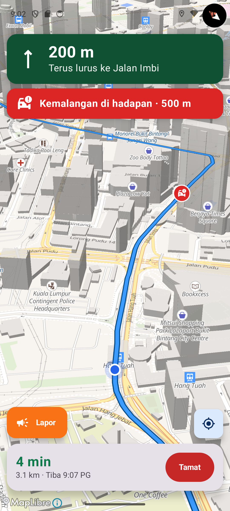
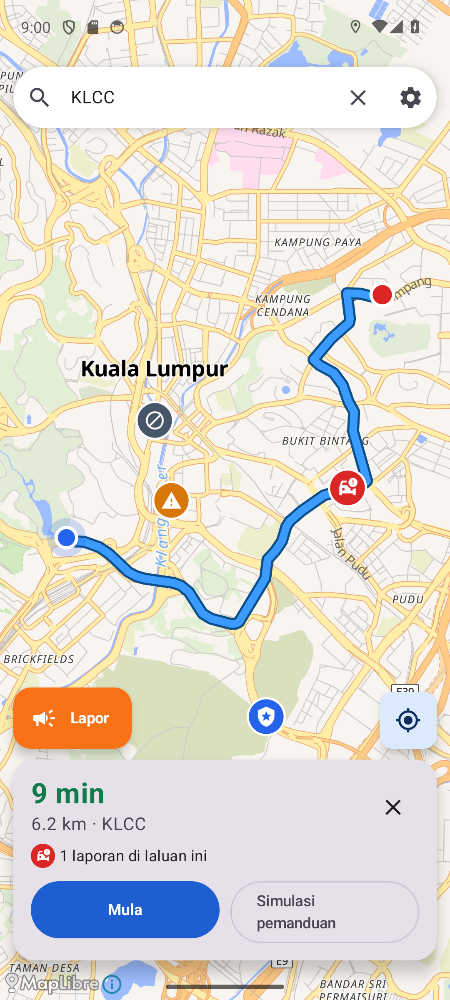
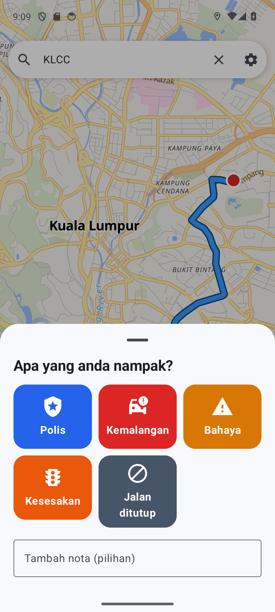
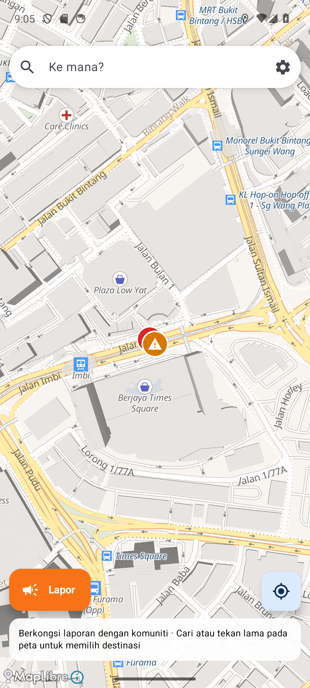

# RoadPulse

[](https://github.com/Tendo505/roadpulse/actions/workflows/ci.yml)


**Community-powered navigation for Android.** Search anywhere in the world, get turn-by-turn directions, and warn other drivers about police, accidents, hazards, traffic jams and road closures. It works straight after install, with no account, no API keys and no tracking.

An original, open-source take on crowd-sourced driving apps, built in **Kotlin** end to end: a Jetpack Compose app and a Spring Boot backend.

**📲 [Download the APK](https://github.com/Tendo505/roadpulse/releases/latest)** (Android 8.0+)

<p align="center">
  
  
  
  
</p>
<p align="center"><sub>Screenshots from the app running in Bahasa Melayu.</sub></p>

## Features

- **Worldwide maps, search and routing** from free OpenStreetMap services: [OpenFreeMap](https://openfreemap.org) vector tiles, [OSRM](https://project-osrm.org) routing, and [Photon](https://photon.komoot.io) search
- **Turn-by-turn navigation** with a tilted, heading-up map that keeps your car in the lower third so you see the road ahead, plus distance to the next turn, a live ETA, off-route detection with automatic rerouting, and arrival
- **Spoken directions and hazard alerts** ("Accident reported ahead in 400 metres") through the phone's built-in text-to-speech
- **Community reports:** report in two taps while driving. Nearby duplicates merge into one report with a confirmation count, and other drivers vote **Still there** or **Not there** to keep the map honest.
- **Simulated drive** to try navigation without moving, useful for demos and testing

### Built so everyone can use it

| | |
| --- | --- |
| **No server needed** | Out of the box, reports are stored on the phone under the same rules as the server. Point Settings at a RoadPulse server to share them with every driver using it. |
| **Any Android phone** | Location comes from Android's own `LocationManager`, not Google Play Services, so it works on phones sold without Google services. minSdk 26 covers about 97% of devices. A 14 MB arm64 APK suits most phones, and a universal APK runs on everything. |
| **Two languages** | Full **English** and **Bahasa Melayu**, including turn instructions, with Android 13+ per-app language support. |
| **Units by country** | Kilometres, or miles and feet where those are the everyday units (US, UK and others), switchable in Settings |
| **Accessible** | Every control has a screen-reader label, turn and hazard banners are live regions so TalkBack announces them, touch targets are 48 dp or larger, text is high-contrast at large sizes, and a dark theme is included. |
| **Private** | No account and no analytics. Each install gets a random anonymous ID, used only for one-vote-per-device and rate limiting. |

## How it works

```
 Android app (Kotlin, Jetpack Compose)                    RoadPulse server (Kotlin, Spring Boot)
 ┌────────────────────────────────────────┐               ┌──────────────────────────────────────┐
 │ MapScreen ── MapViewModel (StateFlow)  │   REST/JSON   │ /api/reports         submit + merge  │
 │   │            │                      │ ────────────▶ │ /api/reports?bbox    map viewport    │
 │ MapLibre    Navigator  ← GPS / simulator│               │ /api/reports/{id}/votes              │
 │ (OSM tiles)    │  progress, next turn, │               │ /api/reports/along-route             │
 │                │  hazards ahead, reroute               │        │                             │
 │            ReportSource                │               │   PostgreSQL / H2  +  Flyway         │
 │   ├─ RemoteReports (shared)            │               └──────────────────────────────────────┘
 │   └─ LocalReports  (on-device, offline)│
 │ Router (OSRM) · Search (Photon)        │  ──▶  free OpenStreetMap services
 └────────────────────────────────────────┘
```

### Interesting parts

**Snapping to the route.** `Navigator` projects each GPS fix onto the route polyline in a local flat (equirectangular) projection. At street scale that's accurate to centimetres and much cheaper than spherical geometry per segment. From the snapped point it derives distance travelled, the next maneuver, the remaining distance and time, and which reports lie ahead within 600 m. Progress never jumps backwards past GPS noise, so a route that loops back near itself doesn't snap to the wrong pass.

**Off-route detection without false alarms.** One bad GPS reading shouldn't trigger a reroute, so the driver must be more than 50 m from the route on **three consecutive fixes**. Getting back on the road resets the count.

**Report merging and voting.** The server treats a new report within 150 m of an active report of the same type as a *confirmation*. Ten drivers passing one accident produce one marker saying "10 confirmed", not ten markers. Each type has its own lifetime (a traffic jam lasts 30 min, a closure 24 h), and confirmations extend it. "Not there" votes remove a report once they outnumber confirmations. One vote per device is enforced by a primary key, and the vote counters change in single atomic `UPDATE`s, so concurrent voters can't lose a count (there's a test with 15 simultaneous votes).

**Reports along a route.** `POST /api/reports/along-route` takes the route geometry, narrows candidates using the database's lat/lon index and the route's bounding box, then keeps reports within a 60 m corridor, sorted by distance along the route. The app uses it to show "2 reports on this route" before you leave.

**Abuse limits.** Each device can send 10 reports per 10 minutes (`429` with `Retry-After` beyond that). Map queries reject areas too large to be useful, and route queries are capped at 5,000 points.

## Testing

**44 tests** across the two halves, all running in CI:

| | Tests | Highlights |
| --- | --- | --- |
| Server | 24 | Geometry (haversine, route matching, antimeridian), merging, TTLs with a controllable clock, voting rules, rate limiting, along-route ordering, 15 concurrent votes with no lost updates, HTTP + validation. Runs on **H2 and real PostgreSQL 16**. |
| Android | 20 | Navigator progress, turns, hazard alerts, off-route and arrival; distance formatting per unit system; parsing real OSRM and Photon responses; on-device report storage (merge, expiry, persistence, corrupt-file recovery); **turn instructions in English and Malay** against the real string resources; and a **full simulated drive through the real ViewModel** that checks the hazard is announced exactly once, the turn is spoken, and arrival is detected |

### Bugs found by running it on a real device

The automated tests passed first, but driving the app on an Android emulator against the live server found eight real problems, all now fixed:

1. Search results reappeared after choosing a place, because a search request still in flight finished afterwards. Pending searches are now cancelled on selection.
2. The keyboard stayed open after choosing a result.
3. The geocoder returned the same place several times. Results are now de-duplicated.
4. The Settings sheet opened half-way, hiding the Save button below the fold. Sheets now open fully.
5. The Report button had no accessible label, so a screen reader would announce only "button". The dump of the accessibility tree caught it.
6. After ending a drive the map stayed tilted and rotated. It now returns flat and north-up.
7. Report markers could cover your own position dot. Your position is now drawn on top.
8. Long report-type names were cut off in Malay ("Jalan ditut…"). Labels now wrap.

I also verified the **R8-minified release APK** end to end (search, routing, maps) to make sure code shrinking hadn't broken MapLibre or serialization.

## Running it

**Phone:** install the APK from [Releases](https://github.com/Tendo505/roadpulse/releases/latest).

**Server, locally:**

```bash
cd server && ./gradlew bootRun          # in-memory database, seeded with sample reports around KL
# or with PostgreSQL:
docker compose up --build               # API on http://localhost:8080, docs at /docs
```

Then in the app open **Settings → Community server** and enter `http://10.0.2.2:8080` (emulator) or your computer's LAN address.

**Server, online for everyone:** the repo includes a [Render](https://render.com) blueprint ([`render.yaml`](render.yaml)) that provisions the API and a PostgreSQL database on the free tier. `DATABASE_URL` from Render, Heroku or Railway is converted to JDBC settings automatically.

**Android, from source:** open `android/` in Android Studio, or run `./gradlew installDebug`.

## Tech

**Android:** Kotlin 2.3 · Jetpack Compose (Material 3) · MapLibre Native · ViewModel + StateFlow · Coroutines · Retrofit + kotlinx.serialization · DataStore · Android TextToSpeech · Robolectric · AGP 9

**Server:** Kotlin · Spring Boot 3.5 · Spring JDBC (`JdbcClient`) · Flyway · PostgreSQL / H2 · springdoc OpenAPI · JUnit 5 · Docker

**Map data:** © [OpenStreetMap](https://www.openstreetmap.org/copyright) contributors, served by OpenFreeMap. Routing by OSRM, search by Photon. RoadPulse identifies itself to these free services with a descriptive User-Agent, as their usage policies ask.

## License

[MIT](LICENSE) © Tendo505
